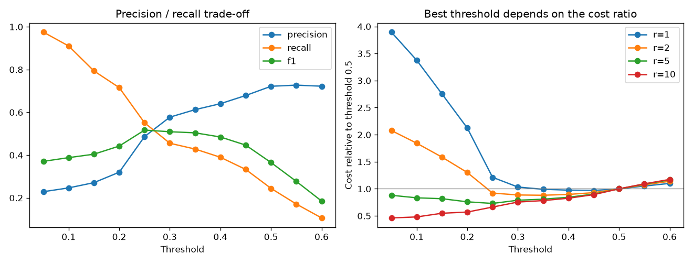

# Credit Default Risk Predictor

Predict the probability that a credit card customer defaults next month, compare the main supervised classification models fairly, choose a decision threshold from an explicit cost assumption, and serve the champion model with FastAPI and Streamlit.

> **Learning project.** This is not a real lending tool. It uses a public dataset from 2005 and makes no claim of regulatory compliance.

**Status:** Phase 1 complete (data, preprocessing, baselines, threshold analysis). Models, explanations, fairness audit and deployment are planned and not started.

## Problem

A lender must decide whether to extend credit. Approving someone who later defaults causes a direct loss; declining someone who would have repaid loses revenue. Because defaulters are a minority, accuracy is a misleading metric, and the right decision threshold depends on how much more a bad approval costs than a bad rejection.

| Item | Definition |
|---|---|
| Task | Binary classification (default = 1) |
| Output | Probability of default, later translated into Approve / Review / Decline |
| Main difficulty | Class imbalance and an assumption-dependent decision threshold |

## Data

UCI *Default of Credit Card Clients* (Taiwan, 2005): 30,000 customers, 23 features (credit limit, demographics, six months of repayment status, bill amounts and payment amounts), licence CC BY 4.0. About 22.1% of customers default.

> Yeh, I. (2009). Default of Credit Card Clients [Dataset]. UCI Machine Learning Repository. https://doi.org/10.24432/C55S3H

Raw data is not committed. `python data/download.py` fetches it.

**Data decisions**
- `SEX`, `AGE` and `MARRIAGE` are **excluded from the model inputs** and kept only for a fairness audit (planned).
- Codes not in the dataset documentation were found in the data: `EDUCATION` 0, 5, 6 (345 rows) and `MARRIAGE` 0 (54 rows). They are merged into the documented "others" category. `PAY_0` also contains `-2` (2,759 rows) and `0` (14,737 rows) with no documented meaning; they are kept as they are and treated as an experiment rather than guessed.
- Train/test split is stratified (80/20, seed 42). The test set is not used until the final comparison.

## Phase 1 results

5-fold stratified cross-validation on the training split (24,000 customers). Precision and recall are at threshold 0.5.

| Model | ROC-AUC | PR-AUC | Precision | Recall |
|---|---|---|---|---|
| Majority baseline | 0.4999 | 0.2212 | 0.000 | 0.000 |
| Logistic regression | 0.7264 | 0.5060 | 0.722 | 0.245 |
| Logistic regression, `class_weight=balanced` | 0.7265 | 0.5045 | 0.373 | 0.664 |

### Findings

- **Accuracy is misleading.** Always predicting "no default" scores 77.9% accuracy and catches none of the defaulters.
- **Class weights move the decision line; they do not improve ranking.** ROC-AUC is 0.7264 without and 0.7265 with balanced weights. Lowering the threshold on plain logistic regression gives a similar precision/recall trade-off.
- **The best threshold depends on the cost ratio.** With cost = r x (false negatives) + (false positives), the lowest cost on the cross-validated predictions was at threshold 0.45 for r=1, 0.35 for r=2 and 0.25 for r=5.
- **Compared with trivial policies, the model helps, modestly.** Against the cheaper of "approve everyone" and "decline everyone", the best threshold lowers cost by about 18% (r=1), 29% (r=2) and 20% (r=5). At r=10 it gives no benefit.
- **Open question:** theory says the best threshold is 1/(1+r) if probabilities are well calibrated. For r=5 that is 0.17, but the data prefer 0.25. A calibration check (planned) will test whether the probabilities are miscalibrated.
- `PAY_0` is a strong signal: default rates are roughly 13-17% for statuses -2 to 0, about 34% at 1 and about 70% at 2 and 3. Statuses of 5 or more have only a handful of customers each, so their rates are unreliable.



### Limitations of these numbers

- Thresholds were picked on the same cross-validated predictions they are measured on, so the cost savings are slightly optimistic. The final threshold will be chosen on validation data and the test set used once.
- The cost ratio r is an assumption, not a measured business figure.
- The dataset is from Taiwan in 2005 and may not describe other populations or periods.

## Project structure

```
data/download.py        download and clean the dataset
src/data.py             loading, stratified split, sensitive-attribute handling
src/preprocess.py       shared preprocessing pipeline (code cleanup, encoding, scaling)
src/metrics.py          ROC-AUC, PR-AUC, precision/recall, cost across thresholds
src/baseline.py         Phase 1 experiments (writes results/ and images/)
tests/                  unit tests
notebooks/              01_eda.ipynb, 02_baseline.ipynb
results/, images/       generated by src/baseline.py
```

## How to run

```bash
python -m venv venv
source venv/bin/activate        # Windows: venv\Scripts\activate
pip install -r requirements.txt
python data/download.py
python -m pytest -q
python src/baseline.py
```

## Roadmap

| Phase | Focus | Status |
|---|---|---|
| 1 | Data, preprocessing, baselines, threshold and cost analysis | Done |
| 2 | Model comparison: decision tree, random forest, gradient boosting (scikit-learn and XGBoost), kNN, Naive Bayes, SVM, MLP (scikit-learn and PyTorch), tuned with cross-validation | Not started |
| 3 | Threshold choice on validation data, calibration, SHAP explanations, fairness audit, model card | Not started |
| 4 | FastAPI service, Streamlit app, Docker, CI, hosted demo | Not started |
